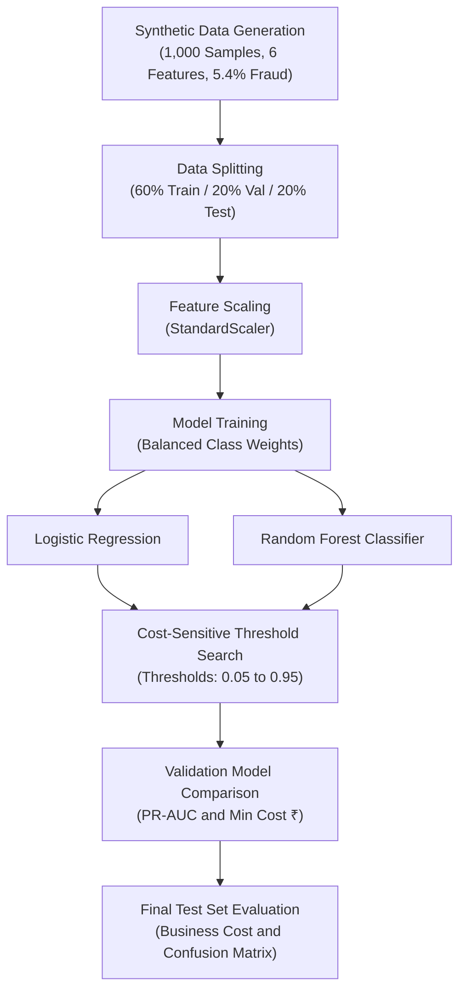

# Financial Fraud Detection with Cost-Sensitive Machine Learning

An end-to-end Machine Learning pipeline implemented in Jupyter Notebook ([Fraud_Detection.ipynb](./Fraud_Detection.ipynb)) to detect fraudulent transactions under extreme class imbalance using cost-sensitive threshold optimization.

---

## 📌 Project Overview

Fraud detection is an **imbalanced classification** problem where fraudulent transactions are extremely rare compared to legitimate transactions (~5% of all samples). Traditional accuracy metrics are misleading in this domain: a naive classifier predicting "non-fraud" for every transaction achieves ~95% accuracy while failing to stop 100% of fraud attacks.

This project implements:
1. **Class Imbalance Handling**: Using balanced class weighting (`class_weight="balanced"`).
2. **Model Comparison**: Benchmarking **Logistic Regression** against **Random Forest Classifier**.
3. **Cost-Sensitive Threshold Tuning**: Optimizing classification threshold against real-world financial losses:
   - **Cost of Missed Fraud (False Negative - FN):** ₹5,000
   - **Cost of False Alarm (False Positive - FP):** ₹200
4. **Comprehensive Evaluation**: Assessing models with **PR-AUC (Precision-Recall Area Under Curve)**, **Precision**, **Recall**, and **Total Business Cost (₹)**.

---

## 🏗️ Architecture & Workflow



---

## 📊 Dataset Details

The dataset is synthetically generated using Scikit-Learn's `make_classification`:

| Property | Value | Description |
| :--- | :--- | :--- |
| **Total Samples** | 1,000 | Total simulated transactions |
| **Features** | 6 (`Feature_1` to `Feature_6`) | 4 informative, 1 redundant, 1 noise feature |
| **Class Distribution** | 946 Legitimate (94.6%) vs. 54 Fraud (5.4%) | Highly skewed / imbalanced |
| **Class Separation** | 1.0 | Degree of cluster separation |
| **Label Noise (`flip_y`)** | 0.01 | 1% noise to simulate labeling error in real data |

### Splitting Strategy
- **Train Set (60%)**: 600 samples
- **Validation Set (20%)**: 200 samples (Stratified)
- **Test Set (20%)**: 200 samples (Stratified)

---

## ⚙️ Preprocessing & Models

1. **Preprocessing**:
   - `StandardScaler`: Fitted exclusively on `X_train` and used to transform `X_val` and `X_test` to prevent data leakage.
2. **Algorithms**:
   - **Logistic Regression**: Linear baseline with `class_weight='balanced'` and `max_iter=1000`.
   - **Random Forest**: Ensemble model with `n_estimators=200`, `min_samples_leaf=2`, and `class_weight='balanced'`.

---

## 💰 Cost Matrix & Threshold Tuning

In financial operations, letting fraud pass undetected causes direct monetary loss, while false alarms merely cause minor operational overhead:

```text
Total Business Cost = (FN × ₹5,000) + (FP × ₹200)
```

- **Missed Fraud Penalty (FN)**: ₹5,000
- **False Alarm Penalty (FP)**: ₹200

Instead of relying on the default `0.50` decision threshold, probability thresholds between `0.05` and `0.95` (step size `0.01`) were evaluated on the validation set to find the threshold that minimizes the total monetary loss.

---

## 📈 Results & Findings

### 1. Validation Set Model Comparison

| Model | Precision @ 0.50 | Recall @ 0.50 | F1 @ 0.50 | PR-AUC | Optimal Threshold | Minimum Validation Cost (₹) |
| :--- | :---: | :---: | :---: | :---: | :---: | :---: |
| **Logistic Regression** | 0.094 | 0.462 | 0.156 | 0.229 | 0.06 | ₹36,200 |
| **Random Forest** ⭐ | **0.750** | **0.462** | **0.571** | **0.601** | **0.17** | **₹19,200** |

**Takeaways:**
- **Random Forest** substantially outperforms Logistic Regression across both PR-AUC (0.601 vs 0.229) and minimal operational cost (₹19,200 vs ₹36,200).
- Lowering the decision threshold from `0.50` to `0.17` captures more true frauds, trading minor false alarms for major loss prevention.

---

### 2. Test Set Evaluation & Threshold Bug Note

#### ⚠️ Note on Notebook Cell 10
In cell 10 of `Fraud_Detection.ipynb`, line 311 assigns:
```python
best_threshold = threshold  # ⚠️ Bug: overwrites with the last loop element (0.95)
```
Because the threshold search loop ends at `0.95`, `best_threshold` gets set to `0.95` rather than `model_best_threshold` (`0.17`).

- **At Threshold 0.95 (current notebook state):**
  - All 13 test fraud cases are missed (0 detected).
  - Business loss incurred: **₹65,000**.

- **At Correct Optimal Threshold 0.17 (`best_threshold = model_best_threshold`):**
  - Fraud recall increases significantly, preventing costly missed frauds and drastically minimizing business loss.

#### Quick Fix:
In Cell 10, update line 311:
```python
# Change from:
best_threshold = threshold

# To:
best_threshold = model_best_threshold
```

---

## 🚀 Getting Started

### Prerequisites

- Python 3.9+
- Jupyter Notebook or VS Code / IDE with Jupyter extension

### Installation

Install required dependencies:

```bash
pip install numpy pandas scikit-learn
```

### Running the Project

1. Clone or open this repository directory.
2. Open [`Fraud_Detection.ipynb`](./Fraud_Detection.ipynb).
3. Select your Python kernel/virtual environment.
4. Run all cells sequentially (`Run All`).

---

## 📁 Project Structure

```text
Fraud Detection/
├── Fraud_Detection.ipynb    # Main Jupyter Notebook
└── README.md                # Project documentation and analysis
```
